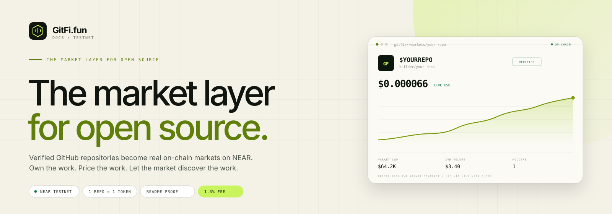
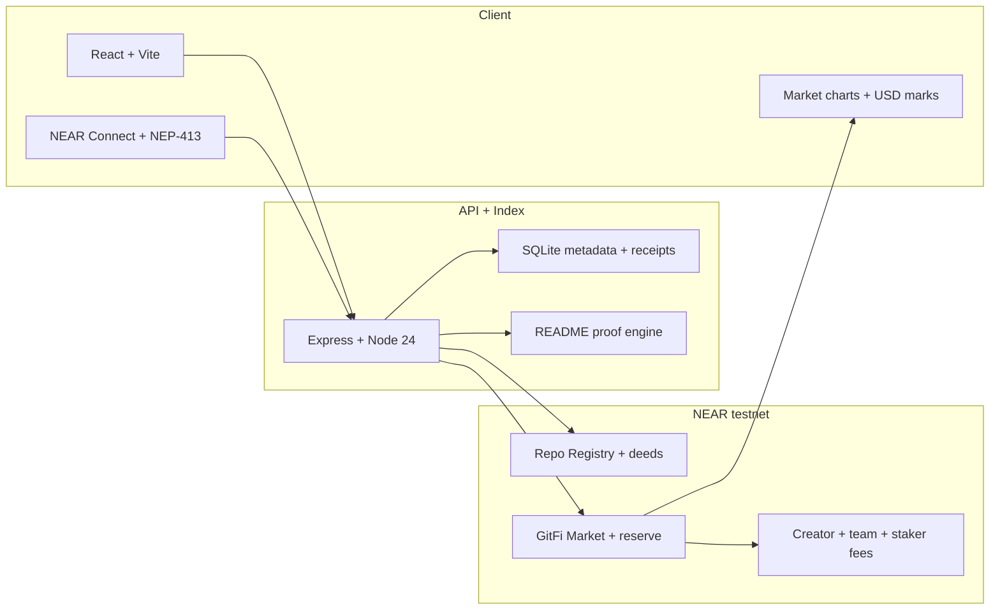

<div align="center">



<br />

# GitFi.fun

**The market layer for open source.**

Turn a public GitHub repository into one verified on-chain market on NEAR.  
Own the work. Price the work. Let the market discover the work.

<br />

[](https://explorer.testnet.near.org/accounts/market.gitfi-395012.testnet)
[](https://gitfi-fun.nurrabby01-bd.workers.dev)
[](https://0xnurrabby.github.io/gitfi/)
[](https://github.com/0xnurrabby/gitfi/actions/workflows/verify.yml)
[](./LICENSE)
[](#proof-of-ownership)

</div>

---

## Open source built the world. The market looked away.

A developer can ship for years and still be invisible. The repository has users, maintenance costs and real cultural gravity, but no price, no ownership layer and no way for the next person to discover it early.

GitFi changes that.

A public repository becomes a verified asset. The owner proves control with one line in the README. The repository gets a deed. The deed gets a market. The market gets a chart, a reserve, holders, staking rewards and a reason for the world to pay attention.

No GitHub OAuth. No custodian. No fake demo balance in the trading path. No second wallet launching a token from someone else's repository.

> **Public code should be able to become an asset without becoming a company.**

---

## Why GitFi exists

<table>
<tr>
<td width="50%" valign="top">

### Builders are invisible

Discovery rewards marketing more than engineering. A foundational repository can have thousands of users and still have no market, no ownership and no sustainable upside for the person maintaining it.

</td>
<td width="50%" valign="top">

### Attention has no price

Stars, forks and downloads are public signals, but nobody can take a position in the work. There is no market price, no cost basis and no way for believers to participate.

</td>
</tr>
<tr>
<td valign="top">

### Traders lack real discovery

New token launches are often disconnected from real work. There is no verifiable link between the asset and the repository behind it, so due diligence becomes guesswork.

</td>
<td valign="top">

### Platforms capture the value

The repo creates the community and the reputation. The platform captures the upside. The maintainer gets a badge and a thank-you.

</td>
</tr>
</table>

GitFi connects the three things that should have been connected from the start:

**a repository, a proof of ownership, and a real market.**

---

## What makes GitFi different

| Most launchpads | GitFi |
|---|---|
| Anyone can launch any token | Only the verified repository owner can create the market |
| Identity is a profile picture | Identity is a public README proof bound to a wallet |
| The asset is a meme | The asset is a real public repository |
| Prices live in a database | Balances, trades and reserves live in a NEAR contract |
| Discovery is paid placement | Discovery is driven by on-chain activity, stars and tiers |
| Traders guess the story | The README, repo, owner and market are on the same page |

GitFi is not a generic token factory. The repository is the product. The market is how the repository becomes legible to capital.

---

## How it works

| Step | What happens | Where it lives |
|---:|---|---|
| **01** | Connect a NEAR wallet with NEAR Connect and NEP-413 | Wallet |
| **02** | Add one sync line to the public README and prove repo control | GitHub + API |
| **03** | Pay the **1 NEAR** launch fee directly to the team wallet | NEAR transfer |
| **04** | The market contract creates the token market and reserve | NEAR contract |
| **05** | Buy, sell, stake, claim and fund bounties with wallet-signed transactions | NEAR contract |

The server verifies the 1 NEAR payment before the market is created. The transaction must be final, signed by the launcher, addressed to the team wallet and never reused.

---

## Proof of ownership

GitFi never asks for a GitHub password, OAuth token or app installation.

Ownership is proven by the one thing only the repository owner can change: the public README.

```text
GitFi.fun sync ID: GF-XXXXXXXX-XXXXXXXX - wallet your-name.testnet - repo owner/repository
```

The server generates a one-time challenge, fetches the raw README and binds the repository to the wallet that added the line.

**Owner-only rules:**

- One repository can have exactly one token.
- Only the README-verified owner can create that token.
- Another wallet cannot launch a market from someone else's repository.
- A second wallet cannot claim an already-verified repository.
- The creator receives no free token allocation.

These rules are enforced by the API and the database, not just by the interface.

---

## The fee model

<table>
<tr>
<td width="50%" valign="top">

### Token creation

**1 NEAR**

Paid directly to the team wallet before launch. Wallet-signed and verified on-chain. One repository, one token, one market.

</td>
<td width="50%" valign="top">

### Every trade

**1.3%**

The creator, the team and the people staking the token all earn from the same activity.

</td>
</tr>
</table>

| Recipient | Share | How it is paid |
|---|---:|---|
| Token creator | **0.50%** | Accrues on-chain, claimed from the market contract |
| Team | **0.30%** | Accrues on-chain, claimed from the market contract |
| Token stakers | **0.50%** | Pro-rata fee yield, claimed in NEAR |
| **Total** | **1.30%** | Creator + team + stakers |

If nobody has staked yet, the staker share remains in the contract as team/platform revenue until staking exists. Once users stake, the 0.5% fee yield flows to them proportionally.

---

## Live on NEAR testnet

| Surface | Status | Proof |
|---|---|---|
| Real wallet login with NEAR Connect + NEP-413 | Live | Wallet picker in the app |
| README proof and repo ownership claims | Live | `/proof` and the repo registry |
| Repo Registry contract | Live | [`gitfi-395012.testnet`](https://explorer.testnet.near.org/accounts/gitfi-395012.testnet) |
| GitFi Market contract | Live | [`market.gitfi-395012.testnet`](https://explorer.testnet.near.org/accounts/market.gitfi-395012.testnet) |
| Wallet-signed buy and sell | Live | Market contract |
| On-chain balances, cost basis and PnL | Live | `/real/:tokenId` |
| 1.3% fee split + claims | Live | Market contract |
| Staking and staking rewards | Live | Market contract |
| On-chain bounties | Live | Market contract |
| On-chain discovery, portfolio and leaderboard | Live | Home, Explore, Portfolio |
| USD display with live NEAR/USD quote | Live | Market pages |
| 1 NEAR launch fee verification | Live | Launch API + NEAR transaction |
| Standalone NEP-141 token per repo | Not yet | Mainnet roadmap |
| External security audit | Not yet | Mainnet checklist |

The old seeded testnet tokens were removed. The active market state is intentionally clean, and every new market must be created by a verified repository owner.

---

## For judges and Claude

If you are evaluating this project, start here:

**Docs judge tour:** https://docs.gitfi.fun/#judges  
**Machine-readable summary:** [`llms.txt`](./public/llms.txt)

### The five-minute route

1. **Home** - read the thesis and the fee equation.
2. **Explore** - see the owner-gated market index.
3. **Launch** - see the README proof, 1 NEAR fee and owner-only checks.
4. **Contracts** - inspect the registry and market on the NEAR explorer.
5. **Proof** - verify the signed receipt ledger and deed pipeline.

### Why this can stand out

| Question | GitFi answer |
|---|---|
| What is the real problem? | Open-source builders create enormous value without a market layer for recognition or upside. |
| What is the new mechanism? | README ownership proof -> one deed -> one market -> wallet-signed trading with creator, team and staker fees. |
| Why NEAR? | Fast finality, low-fee trading, NEP-413 login and a clean wallet-signed transaction model. Remove NEAR and the product does not work. |
| What is honest about the build? | Testnet, step-price market, internal token ledger, no audit yet. The docs call out every boundary. |
| What is the long-term vision? | A discovery and ownership layer for open source, where the best work can be recognised early and the people maintaining it can keep building. |

> The market is not the product. The repository is. The market is how the repository becomes legible to capital.

---

## Architecture



**Settlement:** balances, reserves, trades, staking and bounty escrow live in the NEAR market contract. The server indexes and displays; it does not hold user funds.

**Identity:** NEP-413 wallet login plus a public README proof. No GitHub OAuth token is requested or stored.

**Display:** trading settles in NEAR. Prices, market caps and PnL are shown in USD using a live NEAR/USD quote.

---

## Contracts

| Contract | Address | Owns |
|---|---|---|
| Repo Registry | [`gitfi-395012.testnet`](https://explorer.testnet.near.org/accounts/gitfi-395012.testnet) | Repo deeds, claims, freeze controls, receipt anchors |
| GitFi Market | [`market.gitfi-395012.testnet`](https://explorer.testnet.near.org/accounts/market.gitfi-395012.testnet) | Markets, reserves, balances, trades, staking, bounties |

Selected market methods:

```text
create_market(token_id, repo, ticker, owner, supply, curve_supply, price, step)
buy(token_id)                         payable in NEAR
sell(token_id, token_amount)          pays NEAR from reserve
stake(token_id, token_amount)         token fee yield
unstake(token_id, token_amount)
claim_staking_rewards(token_id)
create_bounty(token_id, title, description)
approve_bounty(bounty_id, winner)
cancel_bounty(bounty_id)
claim_developer_fees(token_id)        creator share
claim_platform_fees()                 team share
get_market / get_balance / get_cost / get_trades / get_bounties
```

Contract source: [`contracts/market/src/lib.rs`](./contracts/market/src/lib.rs)  
Deployment notes: [`contracts/README.md`](./contracts/README.md)

---

## Quick start

**Requirements:** Node.js 24+, npm 11+, Rust and the `wasm32-unknown-unknown` target for contract builds.

```bash
git clone https://github.com/0xnurrabby/gitfi.git
cd gitfi
npm install
cp .env.example .env
npm run dev
```

The API runs on `http://localhost:8787`. The Vite client runs on `http://localhost:5173`.

Useful commands:

```bash
npm run verify        # typecheck, tests, production build
npm test              # economics and market invariant tests
npm run test:smoke    # public UI smoke test
npm run build         # client + server typecheck
npm start             # production server
```

Do not commit `.env`, credentials or the local database. They are ignored by default.

---

## Documentation

The full handbook lives at [`/docs`](./public/docs/index.html) and is designed for the future **docs.gitfi.fun** subdomain.

It covers:

- the story, problem and thesis
- proof of ownership and owner-only launch rules
- market mechanics and the 1.3% fee split
- stars, tiers and discovery
- builder, trader and staker journeys
- architecture, contracts, API and security
- roadmap, FAQ and glossary
- a five-minute judge tour at `/docs/#judges`

Machine-readable project summary: [`llms.txt`](./public/llms.txt)

GitHub Pages preview: `https://0xnurrabby.github.io/gitfi/`  
Live testnet app: `https://gitfi-fun.nurrabby01-bd.workers.dev`  
Production docs target: `https://docs.gitfi.fun`

---

## Repository map

```text
src/
  client/            React app, market pages, docs link, wallet UI
  server/            Express API, README proof, indexer, chain bridge
  shared/            types, economics, formatting
contracts/
  repo-registry/     NEAR repo deed registry
  market/            NEAR market, fees, staking, bounties
public/
  docs/              standalone GitFi handbook
  llms.txt           machine-readable project summary
assets/
  readme-banner.svg  README artwork
tests/               economics and market invariant tests
scripts/             seed reset, smoke and visual checks
```

---

## Roadmap

| Phase | Work | Status |
|---|---|---|
| Testnet | Wallet login, README proof, market, fees, staking, bounties | Live |
| Docs | Story, protocol, contracts, judge tour, machine summary | Live |
| Mainnet prep | Fresh contracts, production owner/treasury, clean database | Next |
| Security | External audit, operational key policy, monitoring | Next |
| Tokens | Optional standalone NEP-141 contract per repository | Later |
| Liquidity | DEX graduation adapter or a clear product decision | Later |
| Scale | Production trade indexer and discovery pipeline | Later |

---

## Security and honest boundaries

- README proof is wallet-bound, one-time and nonce-based.
- Only a verified owner can create the repository token and market.
- Buy, sell, stake, claim and bounty actions are wallet-signed contract calls.
- The sell reserve, creator fees, team fees, staking pool and bounty escrow are tracked separately on-chain.
- The server cannot move user funds.
- The market uses checked integer math and explicit bounds.
- The current build is **testnet** and **not audited**.
- Tokens currently use an internal ledger inside the market contract, not a standalone NEP-141 contract per repository.
- The market is a step-price market, not a full constant-product DEX. Mainnet needs a clear decision on graduation and liquidity.

> Testnet only. Do not treat testnet balances or prices as real financial value.

---

## FAQ

<details>
<summary><strong>Can someone else launch a token from my repository?</strong></summary>
<br />
No. A repository can have one token, and only the wallet that proved README ownership can create it. The API rejects other wallets and the database enforces a single token per repo.
</details>

<details>
<summary><strong>Do you need my GitHub password or OAuth?</strong></summary>
<br />
No. GitFi only reads the public README. Ownership is proven by adding one temporary sync line. No GitHub login or app installation is required.
</details>

<details>
<summary><strong>How much does it cost to launch?</strong></summary>
<br />
1 NEAR, paid directly to the team wallet with a wallet-signed transfer. The server verifies the final transaction before creating the market. The payment cannot be reused.
</details>

<details>
<summary><strong>What does the 1.3% trade fee pay for?</strong></summary>
<br />
0.5% to the token creator, 0.3% to the team and 0.5% to token stakers. Creator and team shares accrue on-chain. Staking rewards are pro-rata and claimable in NEAR.
</details>

<details>
<summary><strong>Do GitHub stars create tokens or yield?</strong></summary>
<br />
No. Stars are a discovery and credibility signal. They influence tier visibility and help traders judge the repository, but they do not mint tokens, create yield or guarantee a price.
</details>

<details>
<summary><strong>Why are prices shown in USD if trading is in NEAR?</strong></summary>
<br />
NEAR is the settlement asset. USD is a familiar display layer powered by a live NEAR/USD quote. The contract always records NEAR amounts and token balances.
</details>

---

## Contributing

GitFi is an experiment in making public work legible to markets without asking builders to give up ownership or leave GitHub.

- Open an issue for bugs, documentation gaps or protocol ideas.
- Keep changes small and verifiable.
- Run `npm run verify` before opening a pull request.
- Do not add demo balances, fake volume or a second token path for the same repository.

---

<div align="center">

**Public code. Priced in public.**

[Website](https://gitfi.fun) · [Live testnet](https://gitfi-fun.nurrabby01-bd.workers.dev) · [Docs](https://docs.gitfi.fun) · [Market contract](https://explorer.testnet.near.org/accounts/market.gitfi-395012.testnet) · [Proof ledger](https://gitfi.fun/proof)

<sub>Built for the NEAR ecosystem. Testnet build. Not audited.</sub>

</div>
